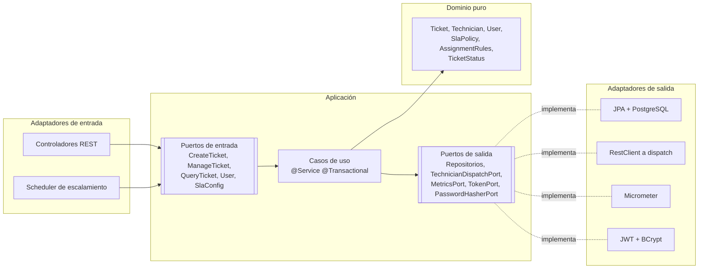
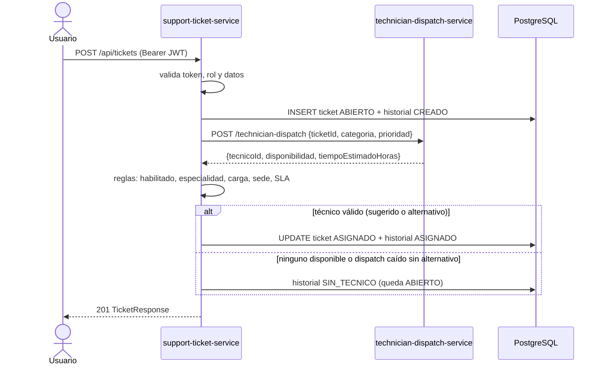
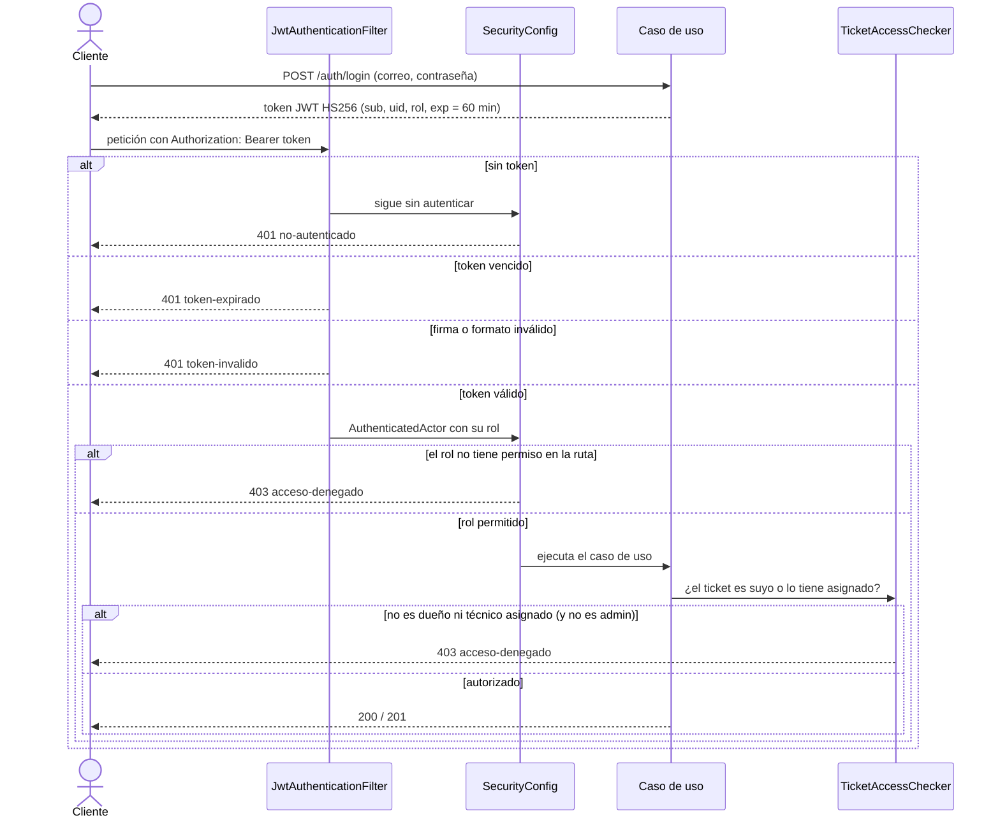
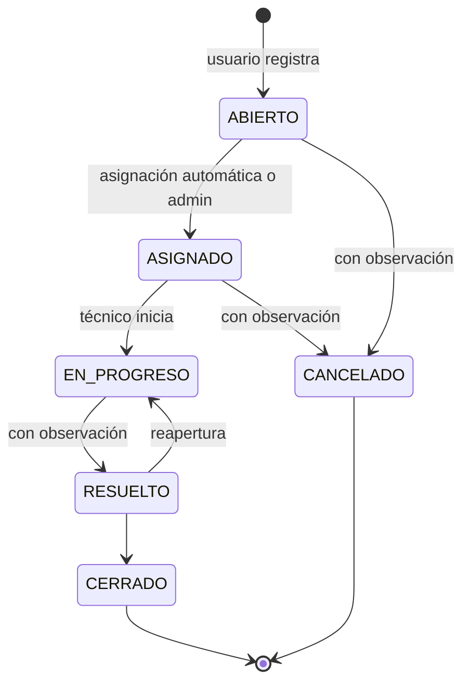

# HelpFlow – Sistema Integral de Gestión de Soporte TI

**Contenido:** [1. Descripción](#1-descripción) · [2. Arquitectura](#2-arquitectura) ·
[3. Tecnologías](#3-tecnologías) · [4. Ejecución](#4-ejecución) · [5. Usuarios de prueba](#5-usuarios-de-prueba) ·
[6. Endpoints](#6-endpoints) · [7. Roles y control de acceso](#7-roles-y-control-de-acceso) ·
[8. Flujo de asignación](#8-flujo-de-asignación) · [9. Transiciones de estado](#9-transiciones-de-estado) ·
[10. SLA y escalamiento](#10-reglas-de-sla-y-escalamiento) · [11. Errores](#11-errores-problemdetail-rfc-7807) ·
[12. Observabilidad](#12-observabilidad) · [13. Swagger y Postman](#13-swagger-y-postman) ·
[14. Supuestos](#14-supuestos-y-decisiones) · [15. Mantenimiento](#15-guía-de-mantenimiento) ·
[16. Solución de problemas](#16-solución-de-problemas) · [17. Evidencias](#17-evidencias)

## 1. Descripción

HelpFlow gestionaba sus solicitudes de soporte por correo, mensajes y hojas de cálculo, lo que producía tickets
duplicados o extraviados, asignaciones sin criterio, falta de trazabilidad e incumplimiento de tiempos.

Este sistema permite **registrar, priorizar, asignar, escalar y cerrar** tickets de soporte TI. Está compuesto por
dos microservicios:

| Servicio | Puerto | Responsabilidad |
| --- | --- | --- |
| `support-ticket-service` | 8080 | Servicio central: usuarios, autenticación JWT, tickets, asignación, SLA, historial y métricas. Arquitectura hexagonal. |
| `technician-dispatch-service` | 8081 | Servicio externo simulado: devuelve de forma determinista un técnico sugerido, su disponibilidad y el tiempo estimado. |

## 2. Arquitectura

### Arquitectura hexagonal (support-ticket-service)



| Capa | Paquete | Contenido | Dependencias |
| --- | --- | --- | --- |
| Dominio | `domain` | Modelos, enums, reglas (transiciones, SLA, asignación), excepciones | Solo Java |
| Aplicación | `application` | Puertos de entrada y salida, casos de uso | Dominio + `@Service`/`@Transactional` |
| Infraestructura | `infrastructure` | REST, JPA, cliente HTTP, seguridad, métricas, configuración | Todo |

Las dependencias apuntan hacia adentro: el dominio no importa ninguna clase de Spring, JPA ni Jakarta.

### Relación entre microservicios (creación de un ticket)



## 3. Tecnologías

Java 21, Spring Boot 3.5, Spring Security + JJWT, Spring Data JPA + Hibernate, PostgreSQL 16, Flyway, MapStruct,
Bean Validation, Actuator + Micrometer + Prometheus, springdoc-openapi (Swagger), JUnit 5, Mockito,
Testcontainers, JaCoCo, Docker y docker-compose.

## 4. Ejecución

### Con docker-compose (recomendado)

```bash
docker compose up --build -d
docker compose ps        # db y dispatch deben aparecer healthy
```

- support-ticket-service: http://localhost:8080 · Swagger: http://localhost:8080/swagger-ui.html
- technician-dispatch-service: http://localhost:8081 · Swagger: http://localhost:8081/swagger-ui.html
- PostgreSQL: `localhost:5433` (usuario y contraseña `helpflow`)

Para detener: `docker compose down` (agrega `-v` para borrar la base).

### Local (desarrollo)

Requisitos: JDK 21, Maven 3.9+ y Docker.

```bash
# 1. Base de datos
docker run --name helpflow-db -d -p 5432:5432 \
  -e POSTGRES_DB=helpflow -e POSTGRES_USER=helpflow -e POSTGRES_PASSWORD=helpflow postgres:16

# 2. Dispatch
cd technician-dispatch-service && mvn spring-boot:run

# 3. Servicio principal (otra terminal)
cd support-ticket-service && mvn spring-boot:run
```

### Variables de entorno (support-ticket-service)

Todas tienen un valor por defecto para desarrollo; en docker-compose se definen en `docker-compose.yml`.

| Variable | Por defecto | Uso |
| --- | --- | --- |
| `DB_URL` | `jdbc:postgresql://localhost:5432/helpflow` | Conexión a PostgreSQL |
| `DB_USER` / `DB_PASSWORD` | `helpflow` / `helpflow` | Credenciales de la base |
| `DISPATCH_URL` | `http://localhost:8081` | URL de technician-dispatch-service |
| `JWT_SECRET` | clave de desarrollo | Clave HS256 en Base64 (mínimo 32 bytes). **Cámbiala en producción** |
| `JWT_EXPIRATION_MINUTES` | `60` | Vigencia del token |

### Pruebas y cobertura

```bash
cd support-ticket-service && mvn verify          # requiere Docker encendido (Testcontainers)
cd technician-dispatch-service && mvn verify
```

`mvn verify` ejecuta todas las pruebas, genera el reporte de cobertura con JaCoCo y **falla si la cobertura de
líneas es menor al 80 %**. El reporte queda en `target/site/jacoco/index.html` de cada servicio (en Mac:
`open target/site/jacoco/index.html`). Se excluyen del cálculo la clase de arranque de Spring y el código generado
por MapStruct.

| Nivel | Qué cubre | Herramientas |
| --- | --- | --- |
| Dominio | Máquina de estados, SLA, escalamiento, reglas de asignación con sus bordes | JUnit 5, pruebas parametrizadas |
| Casos de uso | Flujo de asignación, alternativos, dispatch caído, transiciones, reasignación, usuarios, SLA | Mockito (`@Mock`, `ArgumentCaptor`, `InOrder`) |
| Adaptadores | Cliente HTTP a dispatch (servidor HTTP real), métricas, JWT, tarea programada, errores, Bean Validation | JUnit + servidores y registros en memoria |
| Integración | Flujo completo login → ticket → gestión → cierre, seguridad, expiración de tokens, errores HTTP | Spring Boot Test, MockMvc, Testcontainers |

Las pruebas de integración usan un PostgreSQL real en contenedor, limpian los datos antes de cada prueba
(solo quedan los de `V3`) y reemplazan technician-dispatch-service por un mock, así que son independientes y
reproducibles. El Dockerfile compila con `-DskipTests` porque dentro del build de Docker no hay Docker para
Testcontainers; las pruebas se ejecutan antes con `mvn verify`.

## 5. Usuarios de prueba

Contraseña de todos: `Password123*` (cargados por la migración `V3__datos_iniciales`).

| Correo | Rol | Sede |
| --- | --- | --- |
| admin@helpflow.com | ROLE_ADMIN | BARRANQUILLA |
| ana@helpflow.com | ROLE_USUARIO | BARRANQUILLA |
| luis@helpflow.com | ROLE_USUARIO | MEDELLIN |
| tec001@helpflow.com … tec020@helpflow.com | ROLE_TECNICO | ver tabla |

| Técnicos | Especialidad | Barranquilla | Medellín |
| --- | --- | --- | --- |
| TEC-001 a TEC-004 | HARDWARE | 001, 002 | 003, 004 (inactivo) |
| TEC-005 a TEC-008 | SOFTWARE | 005, 006 | 007, 008 |
| TEC-009 a TEC-012 | RED | 009, 010 | 011, 012 |
| TEC-013 a TEC-016 | ACCESOS | 013, 014 | 015, 016 |
| TEC-017 a TEC-020 | OTRO (generalista) | 017, 018 | 019, 020 |

Carga máxima de cada técnico: 5 tickets activos. TEC-004 está INACTIVO para demostrar la regla de técnico habilitado.

## 6. Endpoints

| Método | Ruta | Rol | Descripción |
| --- | --- | --- | --- |
| POST | `/auth/register` | Público | Registro (siempre ROLE_USUARIO) |
| POST | `/auth/login` | Público | Devuelve JWT |
| GET | `/api/users/me` | Autenticado | Perfil propio |
| GET | `/api/users/{id}` | Propio o ADMIN | Ver usuario |
| PATCH | `/api/users/{id}` | Propio o ADMIN | Editar perfil (estado: solo ADMIN) |
| POST | `/api/tickets` | USUARIO, ADMIN | Crear y asignar ticket |
| GET | `/api/tickets` | Todos | Lista según rol |
| GET | `/api/tickets/{id}` | Dueño, técnico asignado, ADMIN | Detalle |
| GET | `/api/tickets/{id}/historial` | Dueño, técnico asignado, ADMIN | Trazabilidad |
| PATCH | `/api/tickets/{id}/estado` | Técnico asignado, ADMIN | Transición con observación |
| PATCH | `/api/tickets/{id}/reasignar` | ADMIN | Cambiar técnico |
| POST | `/api/tickets/{id}/asignar` | ADMIN | Reintentar asignación automática |
| POST | `/api/tickets/escalamiento` | ADMIN | Ejecutar escalamiento ya |
| GET | `/api/sla` | ADMIN | Ver SLA |
| PUT | `/api/sla` | ADMIN | Configurar SLA |
| GET | `/actuator/health`, `/actuator/info` | Público | Salud e información |
| GET | `/actuator/metrics`, `/actuator/prometheus` | ADMIN | Métricas |
| POST | `:8081/technician-dispatch` | Público | Técnico sugerido (servicio externo) |

## 7. Roles y control de acceso

| Rol | Puede |
| --- | --- |
| ROLE_USUARIO | Crear tickets y consultar **solo los suyos**; ver y editar su perfil |
| ROLE_TECNICO | Consultar y gestionar (cambiar estado) **solo los tickets asignados a él** |
| ROLE_ADMIN | Todo: ver todos los tickets, reasignar, reintentar asignación, configurar SLA, ver métricas |

El control se aplica en dos capas: `SecurityConfig` filtra por rol según la ruta, y `TicketAccessChecker`
(capa de aplicación) valida la propiedad del ticket, que depende de los datos.

### Flujo de autenticación y autorización



| Situación | Respuesta | `type` del ProblemDetail |
| --- | --- | --- |
| Petición sin token | 401 | `no-autenticado` |
| Token vencido (más de 60 min) | 401 | `token-expirado` (el cliente debe volver a iniciar sesión) |
| Token alterado, con otra clave o mal formado | 401 | `token-invalido` |
| Correo o contraseña incorrectos en el login | 401 | `credenciales-invalidas` (mismo mensaje para ambos casos) |
| Rol sin permiso para la ruta | 403 | `acceso-denegado` |
| Ticket o perfil ajeno | 403 | `acceso-denegado` |

Cada 401 y 403 incrementa las métricas `helpflow.auth.fallos` (con el motivo como tag) y
`helpflow.auth.accesos.denegados`.

## 8. Flujo de asignación

1. El usuario registra el ticket; nace en estado **ABIERTO** con `fechaLimiteSla = creación + horas del SLA`.
2. El sistema consulta `technician-dispatch-service` con `ticketId`, `categoria` y `prioridad`.
3. Dispatch devuelve el técnico sugerido, su disponibilidad y el tiempo estimado.
4. Se aplican las reglas internas sobre el sugerido:
   1. Técnico ACTIVO (habilitado).
   2. Especialidad igual a la categoría (OTRO es generalista y atiende todas).
   3. Carga activa (ASIGNADO + EN_PROGRESO) menor que su carga máxima.
   4. Misma sede del ticket.
   5. `ahora + tiempoEstimadoHoras` no supera la fecha límite del SLA.
5. Si el sugerido no cumple, se busca un técnico alternativo de la misma sede que cumpla 1–4, con menor carga.
6. Si hay técnico: el ticket pasa a **ASIGNADO** y se registra el historial. Si no: queda ABIERTO con historial
   `SIN_TECNICO`. Si dispatch no responde, se busca directamente el alternativo: el ticket nunca se pierde.
7. Creación, asignación e historial ocurren en **una sola transacción** (`@Transactional`).

## 9. Transiciones de estado



- Cualquier otra transición responde **409**.
- ASIGNADO solo se obtiene con la asignación (no con el endpoint de estado).
- Pasar a CANCELADO o RESUELTO exige observación (validación cruzada con Bean Validation).

## 10. Reglas de SLA y escalamiento

| Prioridad | Horas límite por defecto | Máximo configurable |
| --- | --- | --- |
| CRITICA | 4 | 8 |
| ALTA | 8 | 24 |
| MEDIA | 24 | 72 |
| BAJA | 72 | 168 |

- El ADMIN configura las horas con `PUT /api/sla`; aplica a tickets nuevos.
- Una tarea programada (cada 5 minutos, configurable con `helpflow.escalamiento.cron`) revisa los tickets activos.
  Si a un ticket le queda **25 % o menos** de su tiempo y no fue escalado, su prioridad sube un nivel y se registra
  el historial `ESCALADO`.
- Un ticket activo con la fecha límite superada cuenta como **vencido** (métrica `helpflow.tickets.vencidos`).

## 11. Errores (ProblemDetail, RFC 7807)

Todas las respuestas de error usan el mismo formato:

```json
{
  "type": "https://api.helpflow.com/errors/transicion-invalida",
  "title": "Transición de estado inválida",
  "status": 409,
  "detail": "Transición no permitida: RESUELTO -> CANCELADO",
  "instance": "/api/tickets/1/estado",
  "timestamp": "2026-10-27T15:00:00.123-05:00",
  "traceId": "4f2c9a0d1b8e4c3fa7d6e5b4c3a2f1e0"
}
```

| Situación | HTTP | type |
| --- | --- | --- |
| Validación de campos | 400 | `validacion` (incluye `errores` por campo) |
| JSON mal formado o enum inválido | 400 | `json-invalido` |
| Parámetro de ruta inválido (`/api/tickets/abc`) | 400 | `parametro-invalido` |
| Sin token | 401 | `no-autenticado` |
| Token vencido | 401 | `token-expirado` |
| Token alterado o mal formado | 401 | `token-invalido` |
| Credenciales incorrectas | 401 | `credenciales-invalidas` |
| Rol sin permiso / ticket ajeno | 403 | `acceso-denegado` |
| Recurso inexistente | 404 | `no-encontrado` |
| Documento/correo duplicado, restricción JPA | 409 | `conflicto` |
| Transición inválida | 409 | `transicion-invalida` |
| Regla de negocio (usuario inactivo, técnico no habilitado) | 422 | `regla-negocio` |
| Error de base de datos | 503 | `base-datos` |
| Error inesperado | 500 | `error-interno` |

El `traceId` también se devuelve en el header `X-Trace-Id` y aparece en cada línea de log de esa petición.

## 12. Observabilidad

Logs estructurados en JSON (formato ECS) con `traceId` en cada línea.

| Métrica | Tipo | Significado |
| --- | --- | --- |
| `helpflow.tickets.creados` (tags `categoria`, `prioridad`) | Counter | Tickets creados |
| `helpflow.tickets.primera.respuesta` | Timer | Creación → primer EN_PROGRESO (promedio = TOTAL_TIME / COUNT) |
| `helpflow.tickets.resolucion` | Timer | Creación → RESUELTO |
| `helpflow.tickets.vencidos` | Gauge | Tickets activos con SLA vencido |
| `helpflow.tickets.escalados` | Counter | Tickets escalados |
| `helpflow.auth.fallos` (tag `motivo`) | Counter | Fallas de autenticación |
| `helpflow.auth.accesos.denegados` | Counter | Accesos denegados |
| `http.client.requests` | Timer | Llamadas a technician-dispatch-service |

Ejemplo: `GET /actuator/metrics/helpflow.tickets.creados?tag=categoria:RED` (token de admin).

## 13. Swagger y Postman

- Swagger: http://localhost:8080/swagger-ui.html (botón **Authorize** con el token de `/auth/login`).
- Colección Postman: `docs/HelpFlow.postman_collection.json`. Importarla y ejecutar *Run collection*
  en orden; los scripts guardan los tokens y el id del ticket automáticamente.

## 14. Supuestos y decisiones

- Los campos “salario, fecha de afiliación” y la regla “afiliado ACTIVO para solicitar crédito” del enunciado se
  consideran un error de copia de otro proyecto y no se implementan.
- El body de dispatch no incluye la sede; la sede se valida en support-ticket-service al aplicar las reglas.
- Dispatch agrupa 4 técnicos por categoría (mismos códigos que la base) para que la sugerencia sea coherente.
- Valores de SLA, umbral de escalamiento (25 %) y carga máxima (5) definidos por el equipo.
- La primera respuesta se mide cuando el técnico pasa el ticket a EN_PROGRESO.
- Para las evidencias de tickets vencidos y escalados se ajustaron por SQL las fechas de tickets de prueba.
- **Límite conocido:** si dos tickets se asignan al mismo técnico en el mismo instante, ambos pueden leer la carga
  antes de guardarse y superar la carga máxima por uno. Se resolvería con bloqueo optimista (`@Version`) o un
  bloqueo de fila sobre el técnico.

## 15. Guía de mantenimiento

### Cambiar el esquema de la base

1. Crea un archivo nuevo en `support-ticket-service/src/main/resources/db/migration/` con el siguiente número:
   `V4__descripcion.sql`, `V5__...`.
2. **Nunca edites una migración ya aplicada** (V1–V3): Flyway guarda su checksum y la aplicación no arrancaría.
3. Ajusta la entidad JPA correspondiente: `ddl-auto: validate` hace fallar el arranque si entidad y tabla no coinciden.

### Agregar un estado de ticket

1. Agrega el valor al enum `TicketStatus` y sus transiciones en `puedePasarA`.
2. Crea una migración que actualice el `CHECK` de la columna `estado` en `tickets` (y `estado_nuevo` si aplica).
3. Si el estado exige observación, agrégalo a `StatusChangeValidator`.
4. Agrega los casos a `TicketStatusTest` y vuelve a ejecutar `mvn verify`.

### Agregar una categoría o un técnico

- **Técnico:** inserta el usuario (rol `ROLE_TECNICO`) y su fila en `tecnicos` con una migración. Si debe recibir
  sugerencias de dispatch, el código `TEC-xxx` tiene que estar en el grupo de su categoría en
  `TechnicianDispatchService`.
- **Categoría:** enum `Category`, `CHECK` de las tablas `tickets` y `tecnicos`, patrón de `DispatchRequest` y el mapa
  de grupos de `TechnicianDispatchService`.

### Operación

| Tarea | Cómo |
| --- | --- |
| Cambiar horas de SLA | `PUT /api/sla` como admin (aplica a tickets nuevos; respeta los máximos por prioridad) |
| Desactivar un usuario | `PATCH /api/users/{id}` con `{"estado":"INACTIVO"}` como admin |
| Reintentar una asignación | `POST /api/tickets/{id}/asignar` como admin |
| Cambiar la frecuencia del escalamiento | Propiedad `helpflow.escalamiento.cron` (expresión cron de Spring) |
| Rotar la clave JWT | Genera una nueva con `openssl rand -base64 32`, defínela en `JWT_SECRET` y reinicia; los tokens anteriores dejan de ser válidos |
| Ver logs | `docker compose logs -f support-ticket-service` (JSON; filtra por `traceId`) |
| Reiniciar la base desde cero | `docker compose down -v` y `docker compose up -d` (Flyway vuelve a aplicar V1–V3) |

### Antes de subir cambios

1. `mvn verify` en ambos servicios (pruebas + cobertura mínima de 80 %).
2. Si cambiaste endpoints, actualiza la colección de Postman y la tabla de endpoints de este README.
3. `docker compose up --build -d` y una ejecución completa de la colección.

## 16. Solución de problemas

| Síntoma | Causa probable | Solución |
| --- | --- | --- |
| `Could not find a valid Docker environment` al correr pruebas | Docker Desktop apagado | Ábrelo y espera a que esté listo |
| `Coverage checks have not been met` | Cobertura menor al 80 % | Abre `target/site/jacoco/index.html` y agrega pruebas a las clases en rojo |
| `port is already allocated` | Puerto 8080, 8081 o 5433 ocupado | Detén la app que lo usa o cambia el puerto en `docker-compose.yml` |
| La app no arranca: `Schema-validation: missing column` | Entidad y migración no coinciden | Revisa la última migración y la entidad |
| La app no arranca: `Migration checksum mismatch` | Se editó una migración ya aplicada | Revierte el cambio y crea una migración nueva |
| 401 `token-expirado` | El token tiene más de 60 minutos | Vuelve a hacer login |
| 401 `token-invalido` tras reiniciar | Cambió `JWT_SECRET` | Vuelve a hacer login |
| Tickets quedan ABIERTO con historial `SIN_TECNICO` | Dispatch caído y sin técnicos alternativos en la sede | Revisa `docker compose ps`, luego `POST /api/tickets/{id}/asignar` |
| `/actuator/metrics` responde 403 | El token no es de admin | Usa `admin@helpflow.com` |

## 17. Evidencias

Capturas en `docs/capturas/`:

| Evidencia | Archivo |
| --- | --- |
| Login y JWT | `01-login.png` |
| Ticket creado y asignado | `02-crear-ticket.png` |
| Historial | `03-historial.png` |
| Transiciones y 409 | `04-transiciones.png` |
| Validación 400 | `05-validacion.png` |
| Acceso denegado 403 | `06-acceso-denegado.png` |
| Dispatch determinista | `07-dispatch.png` |
| Métricas | `08-metricas.png` |
| Tickets vencidos | `09-vencidos.png` |
| Escalamiento | `10-escalamiento.png` |
| Logs JSON con traceId | `11-logs.png` |
| Pruebas en verde | `12-tests.png` |
| docker compose ps | `13-docker.png` |
| Swagger | `14-swagger.png` |
| MapStruct generado | `15-mapstruct.png` |
| Reporte de cobertura JaCoCo | `16-cobertura.png` |
